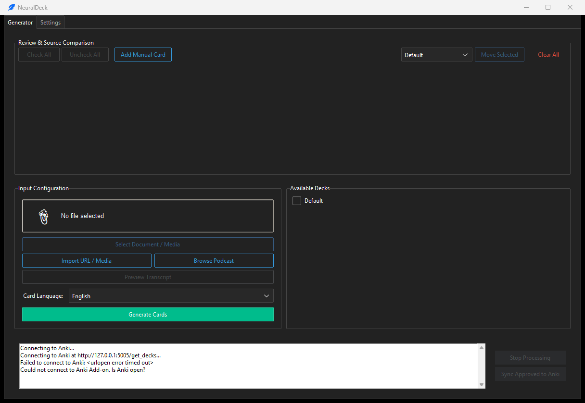

# NeuralDeck 0.2

<!-- aegean:media:start -->
<p align="center"></p>
<p align="center"><a href="LICENSE"></a> <a href="https://github.com/AegeanWorks/AIKit"></a></p>
<!-- aegean:media:end -->


<p align="center">
</p>

<p align="center">
  <b>Your personal, privacy-focused AI assistant for creating Anki flashcards from any document.</b>
  <br />
  <br />
  
  
  
  
  
</p>

---

## Table of Contents

1. [Cold-Start Quick Reference](#-30-second-cold-start-quick-reference)
2. [What's Inside](#-whats-inside)
3. [About](#about)
4. [Why NeuralDeck?](#why-neuraldeck)
5. [Features](#features)
6. [Screenshots](#screenshots)
7. [Quick Start](#quick-start)
8. [Installation](#installation)
   - [Prerequisites](#prerequisites)
   - [Setup NeuralDeck](#1-install-neuraldeck)
   - [Setup Anki Bridge](#2-setup-anki-bridge)
9. [Usage Guide](#usage-guide)
10. [Configuration Settings](#configuration-settings)
11. [Architecture](#architecture)
    - [Module Overview](#module-overview)
    - [Data Flow](#data-flow)
12. [Testing](#testing)
13. [Troubleshooting](#troubleshooting)
14. [Building the Executable](#building-the-executable)
15. [Security](#security)
16. [Contributing](#contributing)
17. [License](#license)

---

## ⚡ 30-Second Cold-Start Quick Reference

- **Runtime Prerequisites**: Python 3.10+, Anki desktop with the NeuralDeck Bridge add-on, and an OpenAI-compatible local LLM server (LM Studio recommended)
- **Canonical Regression Shield Gate**:
  ```bash
  python -m pytest tests
  ```

### 🛠️ AIKit Commands (run from the AIKit workspace root)

| Role | Command |
|---|---|
| Status, task and gates | `python aikit.py status NeuralDeck` |
| Delivery check | `python aikit.py check NeuralDeck` |
| Repair memory and map | `python aikit.py fix NeuralDeck` |
| Resume an interrupted task | `python aikit.py resume NeuralDeck` |

## 📦 What's Inside

```text
NeuralDeck/
├── README.md
├── .gitignore
├── assets/
├── COMMERCIAL.md
├── .aikit/                  <- project memory: project, guidelines, decisions, ledger, map
├── .github/
├── anki_addon/              <- Anki bridge add-on
├── screenshots/             <- README images
├── tests/                   <- regression suite
├── main.py
├── ui.py
├── document_processor.py
├── transcript_formats.py
├── transcript_sources.py
├── web_extraction.py
├── audio_transcription.py
├── pipeline_utils.py
├── settings_io.py
├── anki_integration.py
├── debug_anki.py
├── debug_llm.py
├── requirements.txt
├── requirements-transcription.txt
├── config.example.json
├── LICENSE
├── LICENSES/                 <- REUSE license texts
└── REUSE.toml                <- Machine-readable SPDX metadata
```

---

## About

**NeuralDeck** is a powerful desktop application that transforms your study materials—PDFs, Word documents, PowerPoints, YouTube videos, podcast episodes, website articles, and transcript files—into high-quality Anki flashcards. By leveraging the power of local Large Language Models (LLMs), it keeps document and audio processing private: only the transcript text you explicitly import over a URL is fetched from the web.

It's designed for students, researchers, and lifelong learners who want to automate the tedious process of card creation without sacrificing control or privacy.

---

## Why NeuralDeck?

- **🧠 Intelligent & Automated**: Go from a 300-page textbook to a ready-to-study Anki deck in minutes, not hours.
- **🔒 Private by Default**: Document, audio, and card processing happens locally. A URL import downloads only the transcript text you request; your files and audio are never uploaded.
- **🤖 LLM-Powered**: Utilizes state-of-the-art local LLMs (like Llama 3, Mistral, or Phi-3 via LM Studio) to understand context and generate accurate, relevant questions.
- **🔧 Fully Controllable**: A comprehensive UI allows you to review, edit, approve, or discard every single card before it's synced to Anki.
- **🌐 Multi-Format Support**: Handles `.pdf`, `.docx`, `.pptx`, `.txt`, `.vtt`, `.srt`, transcript `.json`, podcast audio/video, direct media URLs, PDF URLs and website articles.
- **🎙️ YouTube & Podcasts**: Imports YouTube captions and Podcasting 2.0 RSS transcripts, with optional local Whisper transcription for episodes that have no written transcript.
- **🔌 Seamless Anki Integration**: A custom Anki add-on provides a direct bridge for one-click synchronization.
- **⚡ High Performance**: Multi-threaded processing with intelligent concurrency control.
- **🛡️ Resilient**: Built with failure isolation to handle corrupted pages and unstable LLM responses gracefully.

---

## Features

### Core Features

| Feature | Description |
|---------|-------------|
| **Local First Processing** | Connects to any OpenAI-compatible local server, with a default setup for LM Studio. |
| **Multi-Document Support** | Extracts text from PDF, Word (`.docx`), PowerPoint (`.pptx`), and plain text (`.txt`) files. |
| **YouTube, Web & Podcast Sources** | Imports YouTube captions, podcast/Apple URLs, website articles, PDFs, direct audio/video URLs, and transcripts; browse episodes and preview text. |
| **Smart Deck Matching** | Automatically categorizes generated cards into your existing Anki decks by analyzing content. |
| **AI Refinement Mode** | Optional second AI pass for grammar correction, question clarity, and consistency. |
| **High-Density Generation** | Forces exhaustive detail extraction for complex subjects like medicine or law. |
| **Interactive Review & Edit** | User-friendly interface to edit questions, answers, and deck assignments before syncing. |
| **Bulk Operations** | Check/uncheck all cards, add manual cards, and move multiple cards to different decks. |
| **Session Persistence** | Workspace automatically saved. Resume your review session anytime. |
| **Resilient Pipeline** | Handles corrupted document pages and unstable LLM responses without crashing. |

### Advanced Features

- **Deterministic Mode**: Ensures reproducible output for testing and consistency.
- **Debug Mode**: Verbose logging for troubleshooting.
- **Custom Prompts**: Guide AI behavior with custom instructions.
- **Card Density Control**: Low (concepts), Medium (balanced), High (exhaustive).
- **Parallel Processing**: Configurable concurrency for faster generation.
- **Smart Filtering**: Automatic removal of Yes/No questions and duplicate content.
- **Local Audio Transcription**: Optional faster-whisper pass for podcast and video files, with no audio upload.
- **Episode Browser & Preview**: Pick a specific transcribed podcast episode and inspect the imported text before spending LLM time.

---

## Screenshots

### Main Interface

<p align="center">
  
</p>

The main interface provides a clean, intuitive workflow for generating flashcards. Select your document, configure generation settings, and watch as AI-powered cards are created in real-time.

---

## Quick Start

```bash
# 1. Clone and install
git clone https://github.com/Aegean-E/NeuralDeck.git
cd NeuralDeck
pip install -r requirements.txt
cp config.example.json config.json   # optional; use `copy` on Windows cmd

# 2. Install Anki Bridge (see Installation section)

# 3. Run NeuralDeck
python main.py

# 4. Start LM Studio, load a model, start server on port 1234

# 5. Open Anki and enjoy!
```

---

## Installation

### Prerequisites

| Requirement | Version | Notes |
|-------------|---------|-------|
| **Python** | 3.10+ | Required for running the application |
| **Anki** | Desktop | Must be running for sync to work |
| **Local LLM Server** | - | LM Studio recommended |
| **faster-whisper** | Optional | Only for podcast audio/video without a written transcript |

### Recommended LLM Models

- **Meta-Llama-3-8B-Instruct** - Excellent general-purpose model
- **Mistral-7B-Instruct** - Fast and efficient
- **Phi-3-mini** - Lightweight option for older hardware
- Any OpenAI-compatible model via LM Studio, Ollama, or text-generation-webui

### 1. Install NeuralDeck

```bash
# Clone the repository
git clone https://github.com/Aegean-E/NeuralDeck.git
cd NeuralDeck

# Create virtual environment (recommended)
python -m venv venv
source venv/bin/activate  # Linux/macOS
# or
venv\Scripts\activate  # Windows

# Install dependencies
pip install -r requirements.txt

# Optional: Install development dependencies for testing
pip install pytest
```

### Portable Executable (No Installation Required)

If you prefer not to install Python dependencies, you can use the pre-built portable executable:

1. Download the latest release from the [Releases](https://github.com/Aegean-E/NeuralDeck/releases) page
2. Extract the ZIP file to your preferred location
3. Run `NeuralDeck.exe`
4. **Note**: The Anki Bridge add-on must still be installed separately (see below)

> ⚠️ **Important**: Even when using the portable executable, you must install the Anki Bridge add-on to enable synchronization with Anki.

### 2. Setup Anki Bridge

To allow NeuralDeck to communicate with Anki, install the included bridge add-on:

1. Open **Anki**
2. Navigate to **Tools** > **Add-ons** > **View Files**
3. Create a new folder named `NeuralDeckBridge`
4. Copy the contents of the `anki_addon` folder (`__init__.py` and `manifest.json`) from this project into the new folder
5. **Restart Anki**

> **Verification**: Look for `NeuralDeck Bridge running on port 5005...` in the Anki terminal output.

### 3. Optional: Local Audio Transcription

YouTube captions, `.vtt`/`.srt` files and Podcasting 2.0 transcripts need no extra packages. To transcribe a podcast or video file that has no written transcript, install the optional local Whisper adapter:

```bash
pip install -r requirements-transcription.txt
```

The first transcription downloads and caches a Whisper model; afterwards audio is decoded and transcribed on your machine.

---

## Usage Guide

### Step 1: Start Your Local LLM

1. Open **LM Studio**
2. Download and load a model (e.g., `Meta-Llama-3-8B-Instruct`)
3. Navigate to the **Local Server** tab
4. Click **Start Server**
5. Default endpoint: `http://localhost:1234/v1/chat/completions`

### Step 2: Launch Anki

Ensure Anki is running with the NeuralDeck Bridge add-on active.

### Step 3: Run NeuralDeck

```bash
python main.py
```

### Step 4: Generate Cards

1. Click **Select Document / Media** to choose a document, transcript (`.vtt`, `.srt`, `.json`), or podcast audio/video file
2. Or click **Import URL / Media** and paste a YouTube, Apple Podcasts, RSS, website, PDF, direct audio/video, or transcript URL
3. Or click **Browse Podcast** to paste an RSS feed or Apple Podcasts show URL and choose one of its transcribed episodes
4. Click **Preview Transcript** to inspect imported text or extract a local file early; Generate reuses that text
5. Select your target **Language** (e.g., English, Spanish, French)
6. Choose which Anki decks the AI can assign cards to (or let Smart Deck Matching handle it)
7. Configure **Card Density**:
   - **Low**: Big-picture concepts and key definitions
   - **Medium**: Balanced coverage of facts and concepts
   - **High**: Exhaustive detail extraction
8. Click **Generate Cards**

### Media & Transcript Sources

| Source | How to import | Notes |
|--------|---------------|-------|
| YouTube video | Paste a watch, shorts, live or `youtu.be` URL | Uses public captions; disabled/private videos cannot be fetched. |
| Podcast RSS feed | Paste the show's RSS feed URL | The feed must publish Podcasting 2.0 `<podcast:transcript>` links. **Import** takes the newest transcribed episode; **Browse Podcast** lets you pick one. |
| Apple Podcasts | Paste a show or episode URL | Resolved to the show's RSS feed through the iTunes lookup API. Episode URLs are matched by their page title; if the episode has no transcript, use **Browse Podcast**. |
| Website article | Paste a normal article URL | Main article text is extracted; navigation, scripts, cookie banners and related links are removed. |
| PDF URL | Paste a direct `.pdf` link | Extracted with pypdf. Scanned PDFs still need OCR; local PDFs also work via **Select Document / Media**. |
| Direct transcript | Paste a `.vtt`, `.srt`, `.txt`, `.json` or HTML transcript URL | Only the transcript text is downloaded. |
| Direct audio/video URL | Paste a URL ending in `.mp3`, `.mp4`, `.mkv`, `.webm`, `.mov`, etc. | Downloaded to a temporary local file (max 300 MB), transcribed with Whisper, then deleted. |
| Transcript file | Select it with **Select Document / Media** | Best option when a site blocks automated access. |
| Local audio/video | Select the local file | Requires `requirements-transcription.txt`; processing stays local. |

> Spotify episode pages are not RSS feeds; copy the show's RSS address or download the audio for local transcription.

### Step 5: Review & Sync

- Cards appear in real-time in the Review area
- Edit questions/answers directly in the entry boxes
- Change assigned deck from the dropdown
- Check/uncheck cards to approve or discard
- Click **Sync Approved to Anki** to add cards to your collection

### Bulk Operations

- **Check All**: Select all generated cards
- **Uncheck All**: Deselect all cards
- **Add Manual Card**: Create custom cards manually
- **Move to Deck**: Bulk move selected cards to a different deck

---

## Configuration Settings

All settings are accessible in the **Settings** tab and are saved automatically to `config.json`.

<p align="center">
  
</p>

Customize every aspect of the card generation process from the Settings panel. Configure your LLM connection, adjust generation parameters, and fine-tune the AI's output to match your learning needs.

| Setting | Description | Default |
|---------|-------------|---------|
| **Theme** | Any of the 18 standard `ttkbootstrap` themes | `darkly` |
| **API URL** | Local LLM server endpoint | `http://localhost:1234/v1/chat/completions` |
| **API Key** | Server authentication key | `lm-studio` |
| **Model Name** | Model identifier | `local-model` |
| **Temperature** | AI creativity (0.0=deterministic, 1.0=creative) | `0.7` |
| **Max Tokens** | Maximum tokens per response | `-1` (auto) |
| **Card Density** | Detail level: Low/Medium/High | `Medium` |
| **Concurrency** | Parallel threads (auto-limited to CPU cores) | `1` |
| **Filter 'Yes/No'** | Remove simple Yes/No questions | `True` |
| **Smart Deck Matching** | Content-aware deck assignment | `True` |
| **AI Refinement** | Second pass for quality improvement | `False` |
| **Deterministic Mode** | Fixed seed for reproducible output | `False` |
| **Debug Mode** | Verbose logging | `False` |
| **Custom Prompt** | Additional AI instructions | `(empty)` |

By default, `config.json`, `session_cache.json` and `session.log` live beside the app (or the frozen executable). `NEURALDECK_CONFIG` and `NEURALDECK_LOG` override the paths; relative overrides resolve against the app directory, and nested log directories are created. Config/session writes use a lock sibling, `fsync` and an atomic replace, so an interrupted process cannot leave truncated JSON. Malformed JSON is quarantined as `.corrupt_<timestamp>`; an I/O-unreadable file blocks saves until it is fixed. `config.json` is personal and untracked; start from `config.example.json`. ADR-002 records the platform metadata, locking and recovery details.

---

## Architecture

### Module Overview

```
NeuralDeck/
├── main.py                 # Application entry point
├── ui.py                  # Main GUI (ttkbootstrap)
├── document_processor.py  # Document parsing & card generation
├── transcript_formats.py  # VTT/SRT/JSON/HTML transcript parsing
├── transcript_sources.py  # YouTube, podcast, PDF and URL import
├── web_extraction.py      # Readable website article extraction
├── audio_transcription.py # Optional local faster-whisper adapter
├── pipeline_utils.py      # Utilities (stats, validation, logging)
├── settings_io.py         # Settings paths, atomic JSON persistence, numeric parsing
├── anki_integration.py   # HTTP client for Anki bridge
├── anki_addon/           # Anki-side add-on
│   ├── __init__.py       # Bridge server (port 5005)
│   └── manifest.json     # Add-on metadata
├── tests/                # Test suite
└── config.example.json  # Tracked defaults; copy to config.json (personal, untracked)
```

### Detailed Module Documentation

#### `main.py`
Simple entry point that initializes and launches the GUI.

```python
from ui import AnkiGeneratorUI

def main():
    app = AnkiGeneratorUI()
    app.mainloop()
```

#### `ui.py` - User Interface
- **Framework**: ttkbootstrap (Bootstrap-styled Tkinter)
- **Features**:
  - Document selection and processing controls
  - Real-time log display
  - Interactive card review table
  - Settings panel with live updates
  - Concurrent thread management
  - Session state persistence

#### `document_processor.py` - Core Processing Engine

| Function | Description |
|----------|-------------|
| `extract_text_from_pdf()` | PDF text extraction with pypdf, handles encrypted/corrupt files |
| `extract_text_from_pdf_bytes()` | PDF text extraction from a downloaded URL |
| `_extract_text_from_docx()` | Word document parsing via python-docx |
| `_extract_text_from_pptx()` | PowerPoint extraction via python-pptx |
| `_extract_text_from_txt()` | Plain text file reading |
| `_extract_text_from_transcript()` | VTT/SRT/JSON transcript parsing |
| `_extract_text_from_audio()` | Local podcast/video transcription |
| `extract_text_from_document()` | Unified dispatcher for all formats |
| `check_llm_server()` | Connectivity check with fallback TCP probe |
| `call_lm_studio()` | LLM API client with SSE streaming support |
| `smart_chunk_text()` | Context-aware text splitting respecting boundaries |
| `robust_parse_objects()` | JSON extraction from LLM responses (handles noise/markdown) |
| `filter_and_process_cards()` | Card validation, deduplication, deck matching |
| `refine_generated_cards()` | AI-powered quality improvement pass |
| `generate_qa_pairs()` | Main pipeline orchestration with ThreadPoolExecutor |

#### `transcript_sources.py` - Media Import

| Function | Description |
|----------|-------------|
| `extract_youtube_video_id()` | Recognizes watch, shorts, live, embed and `youtu.be` URLs |
| `fetch_youtube_transcript()` | Downloads the best public caption track and labels it from oEmbed metadata |
| `extract_apple_podcast_ids()` | Reads collection and episode ids from Apple Podcasts URLs |
| `resolve_apple_podcast_url()` | Resolves an Apple show/episode page to its RSS feed |
| `parse_podcast_feed_data()` | Parses an RSS feed into all transcribed episodes |
| `parse_podcast_feed()` | Selects one episode from a feed, by newest or episode URL |
| `fetch_podcast_feed()` | Downloads and lists a feed's transcribed episodes |
| `fetch_podcast_transcript_for_ref()` | Downloads only the chosen episode's transcript |
| `fetch_podcast_transcript()` | Downloads the newest transcribed episode from a feed |
| `_pdf_transcript()` | Extracts text from a downloaded PDF |
| `_web_transcript()` | Extracts the readable body of a web article |
| `_download_media_to_temp()` | Streams a bounded audio/video URL to a temporary file |
| `_media_transcript()` | Transcribes downloaded media locally and deletes the temp file |
| `fetch_transcript_from_url()` | Dispatches YouTube, podcast, PDF, website, media and transcript URLs |

#### `web_extraction.py` - Website Articles

| Function | Description |
|----------|-------------|
| `extract_article()` | Drops navigation/scripts/boilerplate and returns the title plus main paragraphs |
| `WebArticle` | Frozen `title` and `text` result |

#### `transcript_formats.py` - Transcript Parsing

| Function | Description |
|----------|-------------|
| `parse_vtt()` / `parse_srt()` | Extract cue text and drop timings, tags and cue numbers |
| `parse_podcast_json()` | Reads Podcasting 2.0 JSON and segment-list variants |
| `clean_transcript_text()` | Normalizes whitespace and removes rolling-caption duplicates |
| `parse_transcript()` | Sniffs the format and returns plain text |
| `read_transcript_file()` | Reads a local transcript file with its extension as a hint |

#### `audio_transcription.py` - Optional Local Speech-to-Text

| Function | Description |
|----------|-------------|
| `is_audio_file()` | Recognizes supported audio/video extensions |
| `is_video_file()` | Separates video containers from audio for UI labels |
| `transcribe_audio()` | Lazily loads faster-whisper and transcribes locally |

#### `pipeline_utils.py` - Utilities

| Class | Description |
|-------|-------------|
| `PipelineStats` | Thread-safe metrics tracking (timing, counts, memory) |
| `FailureLogger` | JSONL logging of failed chunks and rejected cards |
| `CardValidator` | Card quality validation (length, duplicates, content) |
| `ResourceGuard` | File size and chunk count limits |

#### `anki_integration.py` - Desktop Client

| Function | Description |
|----------|-------------|
| `check_anki_connection()` | Ping Anki bridge server |
| `get_deck_names()` | Fetch deck list via HTTP GET |
| `create_anki_deck()` | Send cards via HTTP POST |

#### `anki_addon/__init__.py` - Anki Bridge Server

| Component | Description |
|-----------|-------------|
| `AnkiBridgeHandler` | HTTP request handler |
| `do_GET /get_decks` | Returns deck names from Anki collection |
| `do_POST /add_cards` | Creates cards in Anki |
| `do_OPTIONS` | CORS preflight handling |
| `add_cards_to_anki()` | Core card creation with model/deck management |
| Security | Path traversal prevention, localhost-only enforcement |

### Data Flow

```text
Document (.pdf/.docx/.pptx/.txt), transcript (.vtt/.srt/.json), podcast audio/video
YouTube URL, podcast RSS/Apple URL, website article, PDF URL, direct audio/video URL, transcript URL
  -> document_processor / transcript_sources / web_extraction: extract plain text
  -> Preview Transcript: inspect the source before generation
  -> document_processor: chunk, generate cards through the local LLM
  -> pipeline_utils: validate, deduplicate, match decks
  -> UI review and approval
  -> anki_integration -> Anki Bridge (localhost:5005) -> Anki
```

---

## Testing

NeuralDeck includes a comprehensive test suite covering all core modules.

### Running Tests

```bash
# Run all tests
python -m pytest tests -v

# Or use the test runner
python tests/run_tests.py

# Run specific test file
python -m pytest tests/test_document_processor.py -v

# Run with coverage
python -m pytest tests --cov=. --cov-report=html
```

### Test Coverage

| Module | Test File | Coverage |
|--------|----------|----------|
| Anki Integration | `test_anki_integration.py`, `test_anki_integration_get_deck_names.py` | ✓ |
| Anki Addon | `test_anki_addon_logic.py`, `test_anki_addon_media.py` | ✓ |
| Document Processor | `test_document_processor.py`, `test_document_processor_extra.py` | ✓ |
| Transcript Formats | `test_transcript_formats.py` | ✓ |
| Transcript Sources | `test_transcript_sources.py` | ✓ |
| Web Extraction | `test_web_extraction.py` | ✓ |
| Audio Transcription | `test_audio_transcription.py` | ✓ |
| Pipeline Utils | `test_pipeline_utils.py` | ✓ |
| Settings I/O | `test_settings_io.py` | ✓ |
| Theme Allowlist | `test_ui_themes.py` | ✓ |
| UI Media Chooser | `test_ui_media.py` | ✓ |
| Full Pipeline | `test_pipeline.py` | ✓ |
| Failure Isolation | `test_failure_isolation.py` | ✓ |
| Deterministic Mode | `test_deterministic.py` | ✓ |

**Total: 222 tests** (platform-specific tests are skipped when their prerequisite is absent)

---

## Troubleshooting

### Anki Connection Failed

**Symptoms**: "Could not connect to Anki" error when fetching decks or syncing.

**Solutions**: ensure Anki is open with a profile, the **NeuralDeck Bridge** add-on is installed, port 5005 is free, and the add-on port matches; then restart Anki.

### PDF Text Not Found

**Symptoms**: "No text could be extracted" error.

**Cause**: PDF is likely a scanned image without OCR.

**Solutions**:
1. Use OCR tools (Adobe Acrobat, PDF24, or online services)
2. Convert to text-selectable PDF before processing
3. Try a different PDF source

### Website Article Not Extracted

**Symptoms**: "The page did not contain readable article text" or the preview has only navigation.

**Solutions**:
1. Open the page in a browser and confirm the article is not behind a login or paywall.
2. Paste the article's canonical URL, not a search, category or video page.
3. Save the article as a `.txt`/PDF and load it locally.
4. Script-only pages need the browser-rendered text; copy it into a text file.

### Video or Audio URL Fails

**Symptoms**: "Local media transcription is unavailable" or a download error.

**Solutions**:
1. Run `pip install -r requirements-transcription.txt`; the first transcription downloads the model.
2. Use a direct media URL ending in `.mp3`, `.mp4`, `.mkv`, `.webm` or `.mov`, not a player page.
3. Downloads are capped at **300 MB**; download larger files and split them.
4. Check that the file plays locally and uses a supported codec.

### YouTube Captions Unavailable

**Symptoms**: "Could not fetch captions for YouTube video..." or a request-blocked error.

**Solutions**:
1. Confirm the video has public captions; disabled, private and age-restricted videos cannot be fetched.
2. Try the video in a browser and copy a `.vtt`/`.srt` transcript file instead.
3. If YouTube blocks the network, use a transcript file or transcribe downloaded audio locally.
4. Keep `youtube-transcript-api` at the pinned version in `requirements.txt`.

### Podcast Feed Has No Transcript

**Symptoms**: "No Podcasting 2.0 transcript is published in..."

**Cause**: The show does not link a `<podcast:transcript>` file for its episodes.

**Solutions**:
1. Pick an episode that publishes a transcript.
2. Paste a direct transcript URL instead of the feed.
3. Download the episode audio and select it for local transcription after installing `requirements-transcription.txt`.

### LLM Connection Error

**Symptoms**: "Connection Failed to http://localhost:1234..."

**Solutions**:
1. Open LM Studio and verify model is loaded
2. Start the Local Server (not just Chat)
3. Check firewall rules for localhost
4. Verify API URL matches LM Studio settings

### Memory Issues with Large Files

**Symptoms**: Application slows down or crashes.

**Solutions**:
1. Reduce **Concurrency** to 1
2. Use **Low** Card Density
3. Split large documents into smaller files

---

## Building the Executable

### Using PyInstaller

```bash
# Install PyInstaller
pip install pyinstaller==6.22.3

# Build executable (URL transcript support uses lazy imports)
pyinstaller --noconsole --onefile --name "NeuralDeck" \
  --hidden-import youtube_transcript_api \
  --hidden-import defusedxml \
  --hidden-import defusedxml.ElementTree \
  main.py
```

For a build that also transcribes local audio, add `--collect-all faster_whisper` and build from an environment where `requirements-transcription.txt` is installed. The model itself is downloaded at first use, not bundled.

The executable is created at `dist/NeuralDeck.exe` on Windows.

---

## Security

- **Local Processing**: Documents, transcript files and audio stay on your machine; audio is never uploaded
- **User-Initiated Fetching**: A YouTube or podcast URL import downloads only the transcript text you request; no document, audio or card is sent anywhere
- **Localhost Communication**: Anki bridge restricts to 127.0.0.1 only
- **Path Traversal Protection**: Media file handling includes security checks
- **Input Validation**: Card content is validated before Anki submission

### Data Privacy

| Data | Location | Encryption |
|------|----------|------------|
| Documents | RAM only | N/A |
| Audio / video | Decoded locally; a direct URL is downloaded to a temp file and deleted after transcription | N/A |
| Imported transcripts | RAM only | N/A |
| YouTube / podcast URLs | Sent to their hosts to fetch transcript text | HTTPS where offered |
| Generated Cards | `session_cache.json` beside the resolved config | None |
| Settings | `config.json` beside the app, or `NEURALDECK_CONFIG` | None |
| Logs | `session.log` beside the app, or `NEURALDECK_LOG` | None |

**Recommendation**: Clear `session_cache.json` after syncing sensitive content.

---

## Contributing

Contributions are welcome. Check existing issues, include reproduction steps and logs (enable Debug Mode), and name your OS, Python and Anki versions. Pull requests need a feature branch, tests for new behavior, a green `python -m pytest tests`, and updated documentation.

---

---

<p align="center">
  <sub>Built with ❤️ for learners everywhere</sub>
</p>

<!-- aegean:brand-assets:start -->
## 🎨 Brand Assets

> **AI-Generated Brand Artwork.** The banner and logo are **AI-generated brand assets**. They are illustrative and may not literally depict every feature or the full project scope.
<!-- aegean:brand-assets:end -->

## 📜 License

Free for personal use under the Aegean License 1.1 (AL-1.1); see [LICENSE](LICENSE). Any commercial use needs the Aegean Commercial License 1.0 (ACL-1.0); see [COMMERCIAL.md](COMMERCIAL.md).

<!-- aegean:screenshots:start -->
## Screenshots

<a href="https://github.com/AegeanWorks/NeuralDeck/commit/de99d53"></a>

*commit `de99d53` · 2026-11-03 · window 1216x839 · Generator tab via PrintWindow; Settings resisted scripted clicks (ADR-010)*
<!-- aegean:screenshots:end -->
